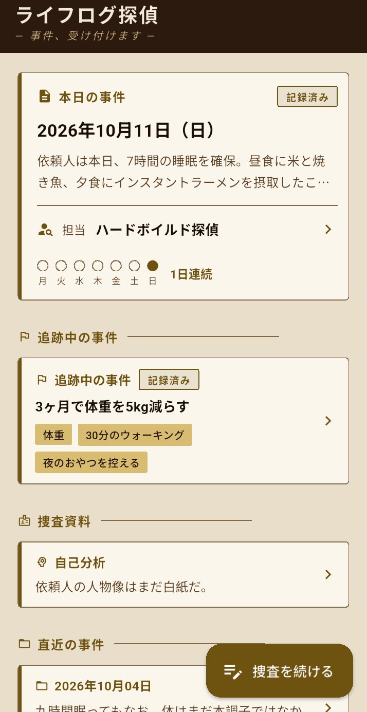
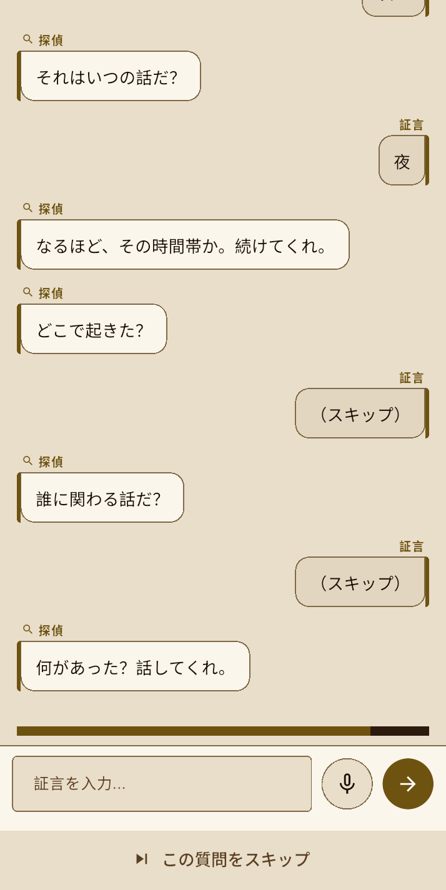
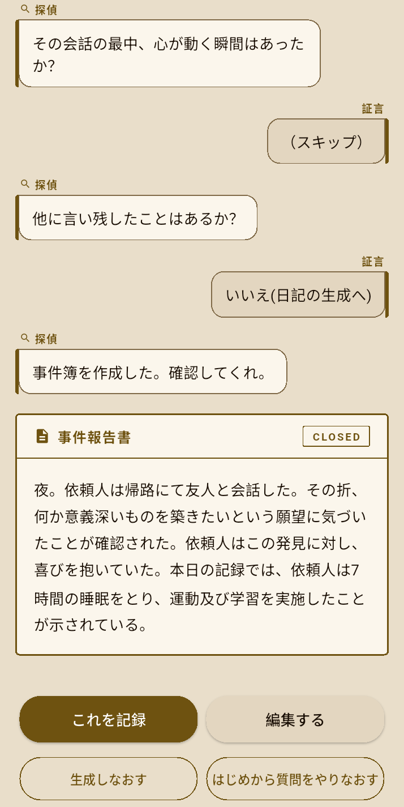
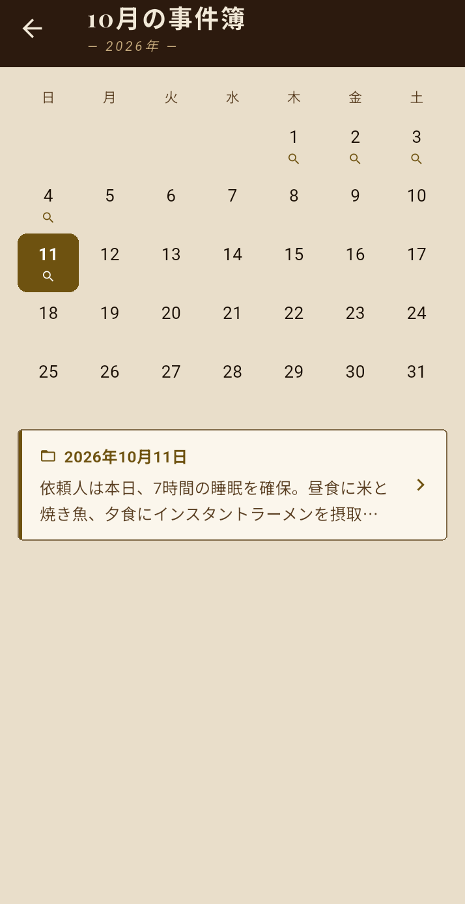
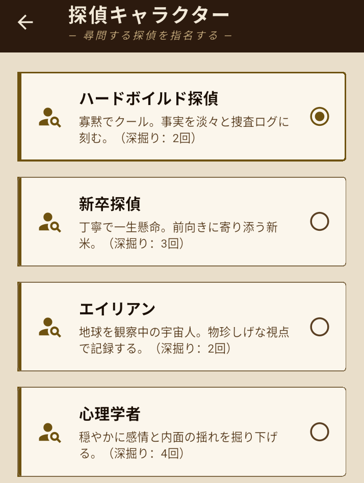
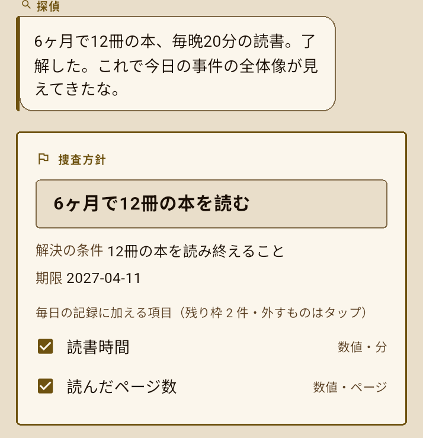
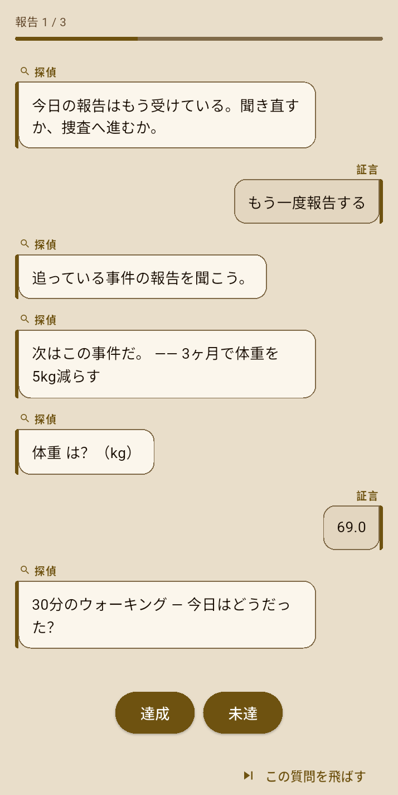
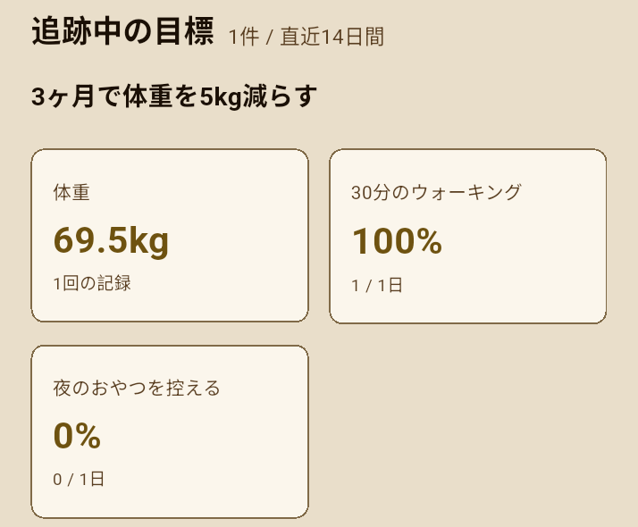

# ライフログ探偵

> AI探偵の質問に答えると日記ができ、目標も数字で追えるスマホアプリ

<p>
  
  
  
</p>

---

## アプリ概要

日記が続かない理由は、「忘れる」「書くのが面倒」「時間がない」の3つだと考え、どれも「自分から書く」ことが前提になっている点に注目しました。ライフログ探偵は、この前提を変えて、探偵に事件の聞き込みを受けるように質問に答えると、AIが日記にまとめるアプリです。

| 続かない理由 | ライフログ探偵の答え |
|---|---|
| 忘れる | 設定した時刻に探偵が通知で呼びに来る。思い出しアシストをオンにすると、午前・午後・夜の順に1日を聞く |
| 書くのが面倒 | 質問は選択肢のタップが基本。短い文章や音声でも答えられ、答えにくい質問はスキップできる。AIが100〜300字の日記にまとめる |
| 時間がない | AIが「十分に聞いた」と判断した時点で、追加の質問を打ち切る。探偵ごとに追加の質問の上限(2〜4回)を決めている |

世界観は一貫して**探偵事務所**です。日記は「事件簿」、過去ログは「事件簿アーカイブ」、記録の振り返りは「証拠分析室」、目標の相談は「相談室」、設定は「探偵事務所」として表現されます。

日記の先に、目標を追う機能もあります。探偵と話して、ふんわりした目標を数字で追える行動項目に分け、毎日の報告と達成率で追えます。

---

## 画面

| 日記の質問 | 事件報告書(日記) | 事件簿アーカイブ |
|:--:|:--:|:--:|
|  |  |  |

| 探偵を選ぶ | 目標を決める(相談室) | 毎日の報告 | 達成率の振り返り |
|:--:|:--:|:--:|:--:|
|  |  |  |  |

---

## 主な機能

| 機能 | 説明 |
|------|------|
| 認証 | Googleログイン / ゲスト(匿名)の2系統。`AuthGate` がログイン状態に応じて画面を出し分ける |
| 通知 | 設定した時刻に毎日ローカル通知を送る |
| 探偵キャラクター | 口調・質問文・日記の文体・追加の質問の回数が異なる4人の探偵から選べる(後述) |
| AIとの対話 | 出来事を5W1H(いつ/どこで/誰が/何があった/どう感じた)で順に質問。選択肢は2択ならボタン、3択以上はドロップダウンで提示 |
| 追加の質問 | 構造化質問のあと、Geminiが会話を読んで追加の質問を生成する。探偵ごとの上限まで繰り返し、「十分に聞いた」と判断すれば打ち切る |
| AIの相槌 | 各回答に探偵が相槌を返す(選択肢はロール定義の固定文面、自由記述はGeminiが生成) |
| 質問のスキップ | 答えたくない質問は飛ばせる。スキップした事実だけが保存され、日記生成には渡されない |
| 音声入力 | 自由記述の回答は、OS標準の音声認識(日本語)でも入力できる |
| 日記の生成 | 会話をもとに、選んだ探偵の文体で100〜300字の日記を作る。生成し直し、手での編集、質問のやり直しができる |
| 追記・作り直し | その日の日記がすでにある場合、「追記する / いちから作り直す / 日記を確認する」を選べる |
| 何もなかった日 | 「何もなかった…」を選んで、出来事の質問を省いて記録できる |
| 事件簿アーカイブ | 月ごとの「本棚」から月のページを開き、カレンダーと選んだ日のプレビューで過去の日記を読み返せる |
| 目標管理 | 探偵と話して目標を数字つきの行動項目に分け、毎日の報告と達成率で追う(後述) |
| 自己分析 | MBTIを登録すると、探偵の質問や所見に反映できる。AIへ渡すかどうかは本人が選ぶ(後述) |
| 証拠分析室 | 探偵の所見、今日の行動、サマリー、追跡中の目標、感情と場所の円グラフ、睡眠の棒グラフ、活動記録(後述) |
| 独自質問 | 自分で質問を追加し、出題する曜日も選べる。対話と分析表に反映される |
| テーマ切替 | 3種のテーマを切り替える(端末ローカルに保存) |
| CSVエクスポート | 全エントリ(日付・日記・回答)をBOM付きCSVに書き出して共有する |
| デモ | ゲストログイン+サンプルの事件簿14日分を一括投入できる(ログイン画面 / デバッグ設定) |

---

## 探偵キャラクター(ロール)

選んだ探偵により、質問文・相槌・日記の文体・追加の質問の回数が変わります。相談室と毎日の報告も、選んだ探偵の口調で進みます。
定義は `lib/roles/` に1ファイル1キャラで分離され、`lib/roles/roles.dart` のレジストリに登録されています。

| キー | 名称 | 特徴 | 追加の質問の上限 |
|------|------|------|:--:|
| `hardboiled` | ハードボイルド探偵 | 寡黙でクール。硬質で簡潔な三人称の捜査ログ調(デフォルト) | 2 |
| `novice` | 新卒探偵 | 入社1日目。ぎこちない丁寧語で一生懸命、前向きに寄り添う | 3 |
| `alien` | エイリアン | 地球を観察中の宇宙人。カタカナ混じりの観測記録調 | 2 |
| `psychologist` | 心理学者 | 穏やかで内省的。事実より「何を感じたか」を掘り下げる | 4 |

各ロールは「人格指示(`interviewerInstruction`)」「質問・ナレーション文面」「ボタン選択への固定リアクション」「日記/所見の文体」「追加の質問の上限(`followUpCount`)」をまとめて持ちます。
新しいロールは `lib/roles/<name>.dart` を追加し、`roles.dart` の `kRoles` に登録するだけで増やせます。ロール選択画面の一覧もレジストリを参照するため、自動で反映されます。

---

## 目標管理

日記の先に、目標を追う機能があります。

1. **相談室で目標を決める**: 探偵と話して、「3ヶ月で5kg減らしたい」のようなふんわりした目標を、数字で追える行動項目に分けます。探偵が見立て(目標・解決の条件・期限・行動項目)を出し、本人が採用する項目を選んで契約します。
2. **毎日の報告で答える**: 日記より先に、探偵が行動項目の進捗を聞きます。数値の項目は入力、できたかどうかの項目は「達成/未達」のタップで答えます。
3. **達成率で振り返る**: 証拠分析室とホームで、目標ごとの達成率と最新の数値を確認できます。達成率は、答えた日だけを母数にして数えます。

設計上の制約:

- 同時に追える目標は3件まで(`kMaxTrackedGoals`)
- 毎日増える行動項目は、全目標を合わせて5件まで(`kMaxTotalGoalActions`)
- 1つの目標あたりの行動項目は3件まで(`kMaxGoalActions`)
- 目標の行動項目には、作成時にクライアント側で不変のIDを振る。ラベルを直しても、過去の回答の紐づけが変わらない
- AIが返した期限は、そのまま保存しない。書式の違うもの、存在しない日付、着手日以前の日付は捨てる(AIに今日の日付も渡す)

---

## 自己分析

ホームの「捜査資料」から、MBTIの16タイプを1つ登録できます(もう一度タップで解除)。登録した内容は、次の2つの用途ごとに、AIへ渡すかどうかを本人が選べます。既定はどちらもオンです。

- 日記の質問・相槌への反映(探偵の質問の切り口を、人物像に合わせる)
- 所見と今日のコメントへの反映(語り口を、人物像に合わせる)

---

## テーマ

設定画面で切り替えられ、選択は `SharedPreferences` に保存されます(起動時のチラつきを避けるため、同期的に読み込みます)。

| テーマ | 説明 |
|--------|------|
| 探偵(ライト) | 羊皮紙のような温かみのあるセピア調 |
| 探偵(ダーク / ノワール) | 深夜の探偵事務所。インク色の闇とゴールド |
| 書斎 | ロンドンの古書斎。緑と真鍮の落ち着いた雰囲気 |

色は `ThemeExtension`(`AppColors`)でドメイン固有のトークン(`gold` / `cardBorder` / `bubbleUser` など)として配信し、`context.colors.gold` の形で参照します。

---

## 日記の質問フロー

ホームの「捜査を開始する」を押すと、追跡中の目標があれば、先に「本日の報告」で行動項目の進捗を聞きます。そのあと、日記の作成(`DiaryPage`)が、内部状態 `_Phase` に沿って次の順序で進みます。

```
(その日の日記がすでにある場合)
   ┗ 追記する / いちから作り直す / 日記を確認する を選択
       ├ 追記する     → 既存日記を初期値に、テキスト編集画面(DiaryEditPage)へ
       ├ 日記を確認する → 既存日記を表示(閉じる / 編集する)
       └ いちから作り直す → 既存日記を破棄し、下記の通常フローを開始

0. いつも通りはじめる / 何もなかった…
1. 独自質問(設定でオンの項目: 睡眠 / 食事 / 運動 / 勉強 + 独自質問)
     → 回答後「この内容も報告書に含めるか?」(はい / いいえ)
2. 思い出しアシスト(設定でオンのときのみ: 午前 → 午後 → 夜)
     → 回答後「この内容も報告書に含めるか?」(はい / いいえ)
3. 作成モード選択(質問に沿って作成 / 自分で入力)
4. 出来事の構造化質問(質問に沿って作成を選んだ場合)
     いつ? → どこで? → 誰が? → 何があった? → どう感じた?
5. AIによる追加の質問(Geminiが会話を読み、探偵ごとの上限まで / 十分なら打ち切り)
6. 追記事項の確認(はい→自由記述 / いいえ→生成へ)
7. 日記の生成 → 確認(これを記録 / 編集する / 生成しなおす / はじめから質問をやりなおす)
8. 完了(事件簿はアーカイブに保存済み。ホームへ / 事件簿アーカイブへ)
```

- 回答対象の質問には「この質問をスキップ」が出て、答えずに次へ進めます。
- 「自分で入力」を選ぶと、AIとの対話を経ずに、テキスト編集画面へ進みます。

---

## 画面構成

下のタブは、事務所(ホーム)/ 事件簿 / 相談室 / 分析室 / 設定の5つです。

| 画面 | 内容 |
|------|------|
| 事務所(ホーム) | 本日の事件(日付・記録の有無・担当探偵・直近7日の記録・連続日数)、追跡中の事件(目標)、捜査資料(自己分析)、直近の事件。「捜査を開始する」から報告と日記へ |
| 事件簿 | 月ごとの本棚 → 月のページ(カレンダー+選んだ日のプレビュー)→ 事件報告書 |
| 相談室 | 追跡中の目標の一覧と、新しい目標を立てる入口。見直し、解決、断念もここから |
| 分析室 | 探偵の所見(直近14日)、今日の行動、サマリー、追跡中の目標、出来事の傾向、睡眠時間、活動記録 |
| 設定(探偵事務所) | アカウント、担当探偵、捜査項目、独自質問、テーマ、通知、データ管理 |

---

## 証拠分析室(AnalyticsPage)

直近14日分のエントリを集計して、次のセクションを縦に並べて表示します。

| セクション | 内容 |
|--------|------|
| 探偵の所見(直近14日間) | 「探偵に推理させる」で、直近14日を読み返したAI所見を生成する。`analyses/latest` にキャッシュし、「再推理」で再生成する |
| 今日の行動(本日分) | 今日の記録に対するAIコメントを生成する。`analyses/today` にキャッシュする(日付が変わると非表示) |
| サマリー(直近14日間) | 平均睡眠 / 運動実施率 / 勉強実施率 / 連続記録日数 |
| 追跡中の目標 | 目標ごとに、数値項目の最新値とチェック項目の達成率を表示する |
| 出来事の傾向 | 感情(`event_how`)・場所(`event_where`)の分布を円グラフで表示する |
| 睡眠時間(直近14日間) | `numericAnswers['sleep']` を棒グラフで表示する |
| 活動記録(直近14日間) | 食事・運動・勉強+独自質問の回答を、日付別の表で表示する |

---

## 設定項目(探偵事務所)

設定はトグル操作のたびに、即時Firestoreへ保存されます。

- **アカウント**: ログイン情報の表示とログアウト(ゲストはデータ喪失を警告)
- **担当探偵**: 質問する探偵を選ぶ
- **捜査項目の選択**
  - その日の印象的なイベント(必須・常時オン)
  - 思い出しアシスト(午前・午後・夜を追加で質問)
  - 睡眠時間 / 食べたもの / 運動習慣 / 勉強内容
- **独自質問リスト**: 質問の追加・削除・出題する曜日の指定
- **テーマ**: 3種から選択(カラープレビューつき)
- **デバッグ**(デバッグビルドのみ): モックデータ投入
- **通知設定**: 毎日のリマインダーのオン/オフと時刻(既定は21:00)
- **データ管理**: CSVエクスポート

---

## 認証

`AuthService`(シングルトン)と `AuthGate` に、認証フローを集約しています。

- **Googleログイン**: `google_sign_in` 7.x の `authenticate()` でIDトークンを取得し、`GoogleAuthProvider` 経由でFirebase Authに通す。`.env` の `GOOGLE_WEB_CLIENT_ID`(FirebaseのWebクライアントID)が必須。
- **ゲスト(匿名)**: `signInAnonymously()`。端末固有で、データの引き継ぎはできない。
- `AuthGate` が `authStateChanges()` を購読し、未ログインなら `LoginPage`、ログイン済みなら `MainShell`(下のタブ)を表示する。各ページは個別にサインインを呼ばない。

---

## 技術スタック

| 種別 | 内容 |
|------|------|
| フレームワーク | Flutter(Dart、SDK `^3.11.1`) |
| 認証 | Firebase Auth(Google / 匿名)+ google_sign_in 7.x |
| DB | Cloud Firestore |
| AI | Google Gemini 2.5 Flash(`google_generative_ai`、モデル `gemini-2.5-flash`) |
| グラフ | fl_chart |
| カレンダー | table_calendar |
| 通知 | flutter_local_notifications + timezone / flutter_timezone |
| 音声入力 | speech_to_text |
| 設定の永続化 | shared_preferences(テーマ) |
| ID発行 | uuid(目標の行動項目・独自質問の不変ID) |
| フォント | google_fonts(Playfair Display など) |
| 共有・出力 | share_plus + path_provider(CSVエクスポート) |
| 環境変数 | flutter_dotenv |

---

## プロジェクト構成

```
lib/
├── main.dart                       # エントリーポイント・初期化
├── firebase_options.dart           # Firebase設定
├── core/
│   ├── goal_progress.dart          # 目標の進捗(達成率・最新値)を算出する純粋関数
│   ├── question_schedule.dart      # 独自質問の出題曜日の判定
│   ├── numeric_answer.dart         # 回答文字列の数値化
│   ├── chart_scale.dart            # グラフの軸の目盛り
│   ├── streak.dart                 # 連続記録日数
│   ├── scroll.dart                 # スクロール補助
│   └── theme/                      # 色トークン・3テーマ・フォント・テーマ永続化
├── models/
│   ├── user_settings.dart          # 設定(探偵・通知・記録項目・独自質問)
│   ├── goal.dart                   # 目標と行動項目(AIの返答の検証を含む)
│   ├── self_analysis.dart          # 自己分析(MBTI・共有トグル)
│   ├── mbti_type.dart              # MBTI 16タイプの定義
│   └── archive_month.dart          # 事件簿の月ごとの集計
├── roles/                          # 探偵キャラクターの定義(1ファイル1キャラ+レジストリ)
├── pages/
│   ├── auth_gate.dart / login_page.dart
│   ├── main_shell.dart             # 下のタブ(事務所・事件簿・相談室・分析室・設定)
│   ├── home_page.dart              # 事務所(ホーム)
│   ├── diary_page.dart             # 日記の作成(AIとの対話)
│   ├── diary_edit_page.dart        # 日記の手動入力・編集
│   ├── diary_list_page.dart        # 事件簿アーカイブ(月ごとの本棚)
│   ├── diary_month_page.dart       # 月のページ(カレンダー)
│   ├── diary_detail_page.dart      # 事件報告書(詳細)
│   ├── consult_hub_page.dart       # 相談室(目標の一覧)
│   ├── consult_page.dart           # 相談室の対話(目標の見立て)
│   ├── goal_check_in_page.dart     # 本日の報告(行動項目の進捗)
│   ├── goal_log_page.dart          # 目標1件の記録の一覧
│   ├── goal_log_detail_page.dart   # 目標の記録の詳細
│   ├── self_analysis_page.dart     # 自己分析
│   ├── analytics_page.dart         # 証拠分析室
│   ├── role_select_page.dart       # 探偵の選択
│   └── settings_page.dart          # 探偵事務所(設定)
├── services/
│   ├── auth_service.dart           # Google / 匿名サインインの一元管理
│   ├── firestore_service.dart      # Firestoreの読み書き・モックデータ投入
│   ├── gemini_service.dart         # Gemini API(対話・日記・分析・相槌・目標の相談)
│   ├── notification_service.dart   # ローカル通知のスケジューリング
│   └── speech_service.dart         # OS音声認識のラッパー
├── prompts/
│   ├── ai_instructions.dart        # ロールに依存しないシステム指示
│   ├── diary_prompts.dart          # 日記のプロンプトのテンプレート
│   └── goal_prompts.dart           # 目標の相談のプロンプトのテンプレート
└── widgets/                        # チャットの吹き出し、日記カード、入力欄、本棚、目標カードなどの共通UI
test/                               # 純粋関数・モデル・ウィジェットのテスト
docs/images/                        # READMEのスクリーンショット
```

---

## データモデル(Firestore)

```
users/{uid}/
├── settings/preferences            # UserSettings(記録項目・探偵・通知・独自質問など)
├── self-analysis/profile           # SelfAnalysis(MBTI・共有トグル)
├── entries/{YYYY-MM-DD}
│   ├── diary: string               # 生成(または手動入力)された日記本文
│   ├── answers: map<string,string> # 質問キー → 回答(event_*, sleep, food, custom_*, ...)
│   ├── numericAnswers: map<string,double> # 数値化した回答(例: sleep)
│   ├── skipped: string[]           # 「質問したが未回答(スキップ)」のキー一覧
│   ├── timestamp: serverTimestamp
│   └── conversation/{autoId}       # 会話ログ(順序復元用の order つき)
│       ├── role: 'ai' | 'user'
│       ├── text: string
│       ├── order: int
│       └── timestamp: serverTimestamp
├── goals/{goalId}                  # 目標(title, metric, deadline, actions[], status など)
│   └── entries/{YYYY-MM-DD}        # その目標の日々の回答(行動項目ごと)
└── analyses/
    ├── latest                      # 直近14日のAI所見のキャッシュ
    └── today                       # 今日の行動コメントのキャッシュ
```

---

## セットアップ

### 必要なもの

- Flutter SDK(`pubspec.yaml` の `environment.sdk` を参照: `^3.11.1`)
- Firebaseプロジェクト(AuthenticationとCloud Firestoreを有効化)
  - Authenticationで、**Google**と**匿名**のサインインを有効化
- Gemini APIキー
- (Googleログインを使う場合)Firebaseの**WebクライアントID**

> **Firestoreのセキュリティルールは `firestore.rules` にあります。** `users/{uid}` 配下を、ログインした本人だけが読み書きできます。自分のFirebaseプロジェクトに反映するには、`firebase deploy --only firestore:rules` を実行するか、Firebaseコンソールの「Firestore → ルール」に内容を貼り付けて公開してください。

### 手順

**1. リポジトリをクローンする**

```bash
git clone <repo-url>
cd nikkinext
```

**2. `.env` ファイルを作る**

プロジェクトルートに `.env` を作ります(`pubspec.yaml` のassetsに登録済み)。`.env.example` をコピーして埋めるのが簡単です。

```
# Gemini API Key(https://aistudio.google.com/ で取得)
GEMINI_API_KEY=your_api_key_here

# FirebaseのWebクライアントID(Googleログインに必須)
# google-services.json の client_type:3 の client_id と同じ値
GOOGLE_WEB_CLIENT_ID=your_web_client_id_here.apps.googleusercontent.com
```

> `GOOGLE_WEB_CLIENT_ID` が未設定だと、Googleログインはエラーになります(ゲスト利用は可能)。
> `.env` はアセットとしてアプリに同梱されます。開発とデモのための構成で、一般に配布する場合は、APIキーをサーバー側に移す必要があります。

**3. Firebaseの設定**

`lib/firebase_options.dart` と、`google-services.json`(Android)・`GoogleService-Info.plist`(iOS)を配置します。
AndroidでGoogleログインを使う場合は、Firebaseに**SHA-1指紋**の登録も必要です。

**4. 依存パッケージをインストールする**

```bash
flutter pub get
```

**5. アプリを起動する**

```bash
flutter run
```

---

## 開発コマンド

```bash
# 依存パッケージのインストール
flutter pub get

# アプリ起動(デバイス/エミュレータが必要)
flutter run

# 静的解析
flutter analyze

# テスト実行
flutter test

# 特定のテストファイルのみ実行
flutter test test/goal_test.dart
```

### デバッグ方法

**VS Code**
1. 右下のバーで、エミュレータのデバイスを選択する
2. `F5` キーを押す(または Run → Start Debugging)

**Android Studio**
1. デバイスセレクタで、エミュレータを起動する
2. ▶ ボタンを押す

---

## アーキテクチャ補足

### `main()` の初期化順序

```dart
WidgetsFlutterBinding.ensureInitialized(); // 1. プラットフォーム呼び出しの前に必須
await dotenv.load(fileName: ".env");        // 2. APIキーの読み込み
await NotificationService.instance.initialize(); // 3. タイムゾーン+通知プラグイン
await Firebase.initializeApp();             // 4. Firebase
await ThemeController.instance.load();       // 5. 保存したテーマを同期的に反映
```

### Gemini の使い方(`GeminiService`)

用途ごとに `GenerativeModel` を分け、それぞれに専用のシステム指示を持たせています(モデルはいずれも `gemini-2.5-flash`)。

- **対話(追加の質問)**: 選択ロールの人格指示。`responseSchema` で `{sufficient, question}` のJSONを強制し、終了判定を堅牢にする
- **相槌**: 同じ人格で、プレーンテキストを返す
- **日記の生成**: `AiInstructions.diaryWriter()` + ロールの `diaryStyle`
- **所見・今日のコメントの生成**: `AiInstructions.analyst()` + ロールの `analystStyle`
- **目標の相談**: 選択ロールの人格指示 + 目標の見立て用のJSONスキーマ。返ってきた見立ては、`Goal.fromAiMap` で検証してから使う(行動項目の件数の上限、ラベルのない項目の除外、期限の検証)

### 拡張ポイント

- **テーマの追加**: `app_theme.dart` の `AppThemeName` と `colorsOf()` に追加する
- **ロールの追加**: `lib/roles/<name>.dart` を作り、`roles.dart` の `kRoles` に登録する(ロール選択画面の一覧は自動で反映される)

---

## 既知の課題

- Androidで、起動のたびに通知の許可画面(アラームとリマインダー)が開く(`NotificationService.initialize` が毎回、正確なアラームの許可を要求するため)
- 端末のタイムゾーン名が、`timezone` パッケージに存在しない値(例: `GMT`)だと、起動時に例外で止まる
- 目標を見直した直後、分析室の表示が、アプリを再起動するまで古い目標の内容のままになることがある
- 音声入力と通知は、エミュレーターでは確認できていない(実機で確認する)

---

## 今後の予定

- 探偵キャラクターの追加(日記の語り口や体験の幅を広げる)
- 日記の質問の流れの見直し(もっと短い時間で終わるようにする)
- 過去の記録を踏まえた質問
- 深掘りの度合いのユーザー設定

---

## 注意事項

- `.env` はGitに含まれません。各自で作成してください(`.env.example` を参照)。
- `pubspec.yaml` を変更したら、必ず `flutter pub get` を実行してください。
- ゲスト(匿名)ログインのデータは端末固有で、別端末からは参照できません。
- 通知・音声入力は、端末の権限許可が前提です(初回の利用時に権限ダイアログが出ます)。
